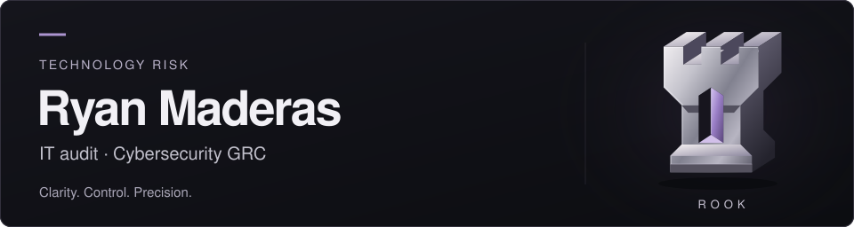

<picture>
  <source media="(max-width: 600px)" srcset="assets/profile-banner-mobile.svg" />
  
</picture>

 

I'm **Ryan Maderas**, a BS Information Technology student at **Mapúa University**, building practical tools at the intersection of software, access controls, and audit evidence.

My background includes an associate degree in cybersecurity and previous IT and compliance-related experience at an authorized Kia dealership operation. I'm pursuing a career in **IT Audit, Technology Risk, Identity & Access Management, and Cybersecurity GRC**.

---

## ♜ ROOK

**Flagship project · Active private development** 
Historical leaver-access IT audit testing workbench.

ROOK helps an auditor investigate a specific question: **Was a former employee's system access disabled within the approved policy deadline?**

- **Test the history.** Import HR records, application accounts, and access events; evaluate access removal deterministically against configurable deadlines.
- **Trace the evidence.** Identify potential exceptions, examine investigation timelines, and follow results back to source records.
- **Document the judgment.** Record human review and conclusions; export reproducible CSV workpapers and JSON evidence packages.

**v0.1 implemented, tested, independently code-reviewed, and merged into main.** A synthetic-data, local-demo prototype; not production-ready enterprise software. Source remains private.

> Potential exceptions are not confirmed findings. Missing evidence never establishes a pass. Current disabled status does not prove timely historical removal. Final audit conclusions belong to human reviewers.

TypeScript · Next.js · React · Tailwind CSS · Vitest · Playwright

Built with AI assistance, with deterministic evaluation and human review kept separate.

---

## Selected projects

### [IT128 · C# and database coursework](https://github.com/ry-une/maderas-IT128)

A blog data-access library, console application, and SQL Server database project. Academic work exploring application structure and database interaction.

C# · .NET · SQL Server

### [Casa Philippines · Static website](https://github.com/ry-une/Casa-Philippines)

A bakery website with home, about, menu, and contact pages. A front-end learning project using Bootstrap components; the contact form is a demonstration without a backend.

HTML · CSS · Bootstrap

---

## Technical foundation & interests

**Building with** — TypeScript, React, Next.js, Tailwind CSS, C#, .NET, SQL Server, HTML, CSS, and Git.

**Engineering practice** — Input validation, deterministic business rules, unit and browser testing, and traceable exports.

**Developing depth in** — IT audit, technology risk, identity and access management, control testing, evidence quality, and cybersecurity GRC.

## Education & professional development

- **Mapúa University** — BS Information Technology, in progress · Dean's Lister
- **Southern New Hampshire University** — Associate Degree in Cybersecurity · Summa Cum Laude
- **CISA examination** — Currently studying; not CISA-certified

## Connect

[LinkedIn](https://www.linkedin.com/in/ryune)

Open to conversations about IT audit, technology risk, IAM, and practical audit tooling.

---

**Clarity. Control. Precision.**
